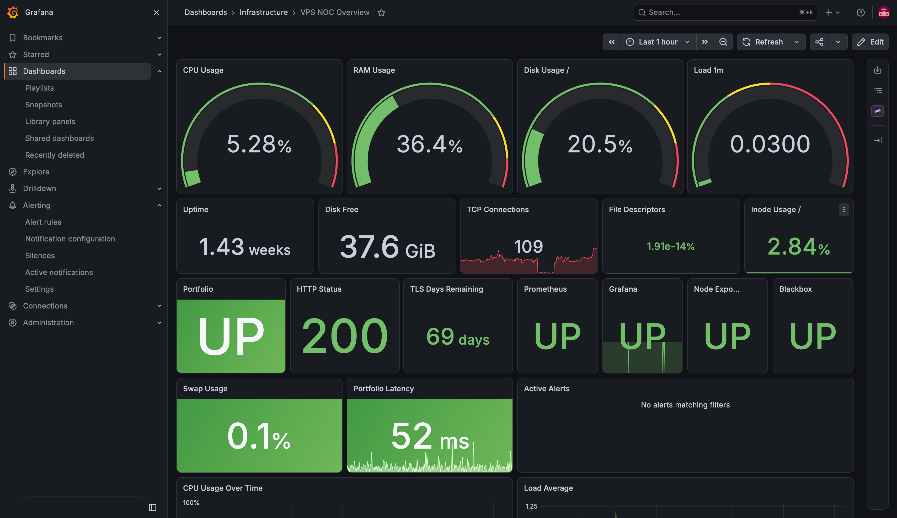
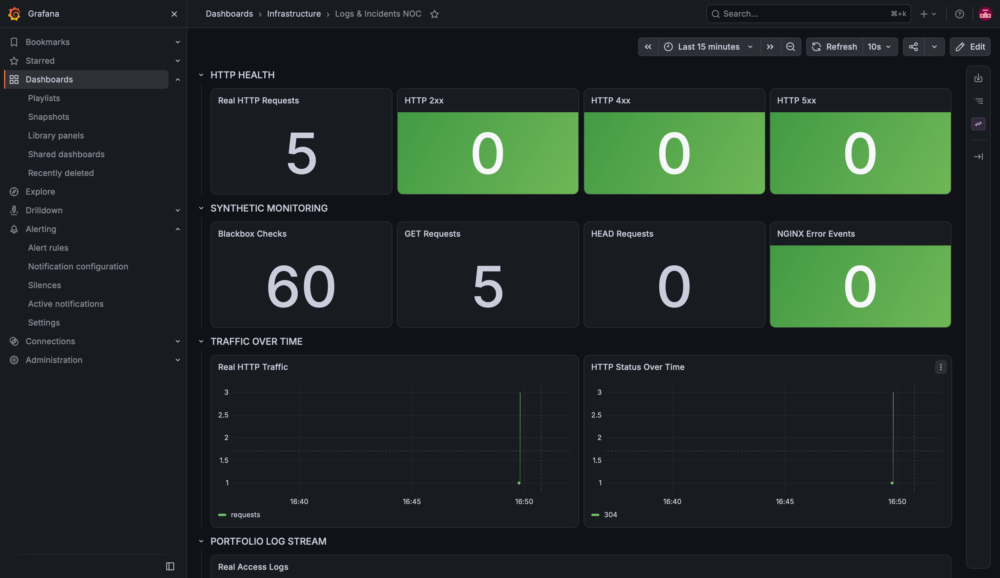
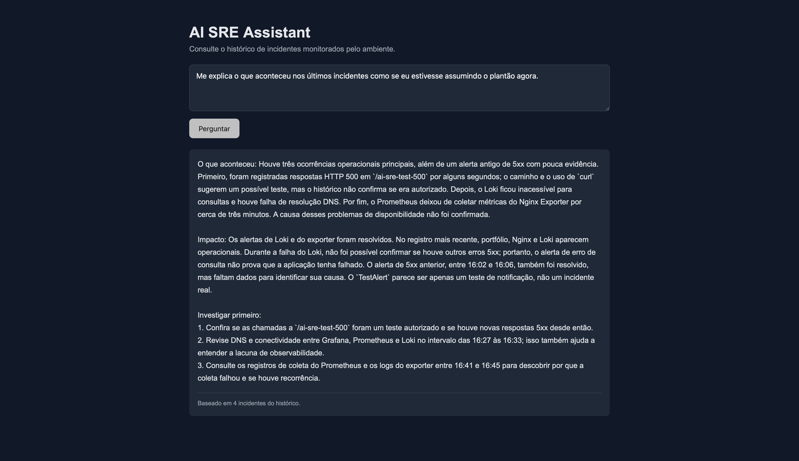

# AI SRE Monitor

> From detection to the first actionable diagnosis.

AI SRE Monitor is an observability and incident-triage project designed to reduce the time between detecting a problem and understanding where to start investigating.

The platform combines **Prometheus, Grafana, Loki, Alloy, Docker and a Python/FastAPI AI agent** to correlate alerts, metrics and logs before generating an operational diagnosis.

## Architecture

```text
Infrastructure / Application
          |
          v
 Prometheus + Loki
          |
          v
    Grafana Alerting
          |
     +----+----+
     |         |
     v         v
Operational   AI SRE Agent
  E-mail          |
                  +-- Prometheus
                  +-- Loki
                  +-- LLM analysis
                  +-- SQLite history
                         |
                         v
                  AI SRE Assistant
```

## Main Stack

- Prometheus
- Grafana
- Grafana Loki
- Grafana Alloy
- Node Exporter
- Nginx Prometheus Exporter
- Blackbox Exporter
- Python
- FastAPI
- Docker Compose
- SQLite
- Nginx
- Cloudflare
- Tailscale

## What the AI Agent Does

When Grafana detects an incident, the AI SRE Agent receives the alert and collects additional context from Prometheus and Loki.

Instead of only returning that an alert fired, the agent tries to answer:

- What happened?
- Is the problem still happening?
- What was the impact?
- What evidence supports the diagnosis?
- Where should the operator investigate first?

Prometheus and Loki remain the technical sources of truth. The AI layer is used to interpret evidence and assist incident triage.

## Incident Flow

```text
Alert
  |
  v
Grafana
  |
  v
Webhook
  |
  v
AI SRE Agent
  |
  +-- Metrics
  +-- Logs
  |
  v
Context Analysis
  |
  v
Probable Cause
  |
  v
Investigation Steps
```

## AI SRE Assistant

The project also includes an operational assistant capable of analyzing stored incident history.

Example question:

```text
Explain the latest incidents as if I were taking over the on-call shift.
```

The assistant summarizes related incidents, separates historical conditions from the current state and provides concise investigation steps.

## Monitoring

The environment monitors:

- Portfolio availability
- CPU usage
- Memory usage
- Disk usage
- HTTP 5xx errors
- Application latency
- TLS certificate expiration
- Loki availability
- Alloy availability
- Node Exporter availability
- Nginx Exporter availability

## Controlled Incident Tests

The architecture was validated using controlled failure scenarios.

### HTTP 5xx

A temporary endpoint returned HTTP 500 responses to validate the complete observability flow:

```text
Nginx -> Alloy -> Loki -> Grafana -> AI SRE Agent
```

The test endpoint was removed after validation.

### Loki Outage

Loki was temporarily stopped to validate detection of an observability-layer failure.

The environment detected the outage and the agent differentiated the Loki failure from the state of the monitored application.

### Nginx Exporter Outage

The Nginx Exporter was stopped while the website remained available.

This validated the distinction between an application outage and a telemetry/monitoring outage.

## Security

The project follows a least-exposure approach:

- administrative services bound to localhost;
- private administrative access;
- secrets stored in environment variables;
- `.env` excluded from Git;
- incident database excluded from Git;
- backups excluded from Git;
- no automatic remediation;
- human-in-the-loop for operational decisions.

Sensitive credentials are **not stored in this repository**.

## Human in the Loop

The AI agent provides diagnostic guidance but does not restart services, change firewall rules or perform destructive actions automatically.

Its purpose is to assist the operator, not replace operational decision-making.

## Alerting as Code

Grafana resources are provisioned declaratively, including alert rules, notification policies, dashboards and datasources.

## Project Structure

```text
ai-sre-monitor/
|-- ai-agent/
|-- alloy/
|-- blackbox/
|-- docs/
|   `-- screenshots/
|-- grafana/
|-- loki/
|-- prometheus/
|-- .env.example
|-- .gitignore
|-- docker-compose.yml
`-- README.md
```

## Running the Project

```bash
git clone https://github.com/Gabrielpalhanogomes2803/ai-sre-monitor.git
cd ai-sre-monitor
cp .env.example .env
cp grafana/provisioning/alerting/contact-points.example.yml grafana/provisioning/alerting/contact-points.yml
docker compose config --quiet
# After completing the host-specific prerequisites below:
docker compose up -d --build
```

### Host-specific prerequisites

Before starting, review docker-compose.yml and the examples:

- Fill the local .env SMTP settings; never commit real values.
- Provision /etc/ai-sre-agent.env securely on the Docker host: the Compose file requires it.
- Review the Nginx access-log mount and the exporter target at 172.18.0.1:8080.
  That address depends on the host network and is not portable.
- Review the copied Grafana contact points before starting notifications.
- docker compose config --quiet checks configuration without printing resolved secrets;
  it does not prove the services can start or reach their dependencies.

The README corrections do not constitute a fresh deployment test.

## Screenshots

### VPS NOC Overview



### Logs & Incidents NOC



### AI SRE Assistant



## Future Improvements

- automated tests;
- incident correlation;
- datasource failure classification;
- AI agent observability;
- runbooks;
- ticketing integrations;
- Docker image version pinning;
- development and production environment separation.

## Project Goal

The goal is not to build an autonomous SRE.

The goal is to reduce the path between:

> **Something is wrong.**

and:

> **I know where to start investigating.**

## Author

**Gabriel Gomes**

Infrastructure | Cloud | DevOps | SRE | Observability

Portfolio: https://gabrielgomes.cloud
